# MedShare: ER Diagram

Crow's-foot notation (Mermaid). Attributes are abbreviated to keys and the most important columns. The full attribute list with keys and constraints is the data dictionary in [`backend/docs/PHASE1_DATABASE_DESIGN.md` §5](backend/docs/PHASE1_DATABASE_DESIGN.md); the authoritative DDL is [`backend/db/migrations/001_schema.sql`](backend/db/migrations/001_schema.sql).

```mermaid
erDiagram
  USERS ||--o{ USER_ROLES : holds
  ROLES ||--o{ USER_ROLES : granted_as
  ORGANIZATIONS |o--o{ USER_ROLES : scopes
  USERS ||--o{ FACILITY_USERS : assigned
  FACILITIES ||--o{ FACILITY_USERS : staffed_by
  ROLES ||--o{ FACILITY_USERS : as_role
  ROLES ||--o{ ROLE_PERMISSIONS : has
  PERMISSIONS ||--o{ ROLE_PERMISSIONS : granted_by

  ORGANIZATIONS ||--o{ FACILITIES : operates
  REGIONS ||--o{ FACILITIES : located_in
  REGIONS |o--o{ REGIONS : parent_of
  ORGANIZATIONS ||--o{ ORGANIZATION_AGREEMENTS : party_a
  ORGANIZATIONS ||--o{ ORGANIZATION_AGREEMENTS : party_b

  MEDICINE_CATEGORIES |o--o{ MEDICINE_CATEGORIES : parent_of
  MEDICINE_CATEGORIES ||--o{ MEDICINES : classifies
  MEDICINE_UNITS ||--o{ MEDICINES : dispensed_in
  MEDICINES ||--|{ MEDICINE_INGREDIENTS : composed_of
  SUBSTANCES ||--o{ MEDICINE_INGREDIENTS : appears_in
  MEDICINES ||--o{ MEDICINE_BATCHES : produced_as
  MANUFACTURERS ||--o{ MEDICINE_BATCHES : makes

  FACILITIES ||--o{ INVENTORY : holds
  MEDICINE_BATCHES ||--o{ INVENTORY : stocked_as
  INVENTORY ||--o{ INVENTORY_MOVEMENTS : changed_by
  MOVEMENT_TYPES ||--o{ INVENTORY_MOVEMENTS : typed_as
  USERS ||--o{ INVENTORY_MOVEMENTS : performed
  FACILITIES ||--o{ FACILITY_MEDICINE_SETTINGS : configures
  MEDICINES ||--o{ FACILITY_MEDICINE_SETTINGS : policy_for

  FACILITIES ||--o{ STOCK_REQUESTS : raises
  STOCK_REQUESTS ||--|{ STOCK_REQUEST_ITEMS : lines
  MEDICINES ||--o{ STOCK_REQUEST_ITEMS : requested

  INVENTORY ||--o{ REDISTRIBUTION_RECOMMENDATIONS : source
  FACILITIES ||--o{ REDISTRIBUTION_RECOMMENDATIONS : destination
  REDISTRIBUTION_RECOMMENDATIONS |o--o| TRANSFER_REQUESTS : accepted_as

  FACILITIES ||--o{ TRANSFER_REQUESTS : source
  FACILITIES ||--o{ TRANSFER_REQUESTS : destination
  TRANSFER_REQUESTS ||--|{ TRANSFER_ITEMS : contains
  MEDICINE_BATCHES ||--o{ TRANSFER_ITEMS : of_batch
  TRANSFER_ITEMS ||--o| STOCK_REQUEST_FULFILMENTS : fulfils
  STOCK_REQUEST_ITEMS ||--o{ STOCK_REQUEST_FULFILMENTS : fulfilled_by
  TRANSFER_REQUESTS ||--o{ TRANSFER_APPROVALS : approved_by
  TRANSFER_REQUESTS ||--|{ TRANSFER_STATUS_HISTORY : history
  TRANSFER_ITEMS ||--o{ INVENTORY_MOVEMENTS : realised_by

  INVENTORY ||--o{ EXPIRY_ALERTS : flags
  FACILITY_MEDICINE_SETTINGS ||--o{ SHORTAGE_ALERTS : breaches
  USERS ||--o{ NOTIFICATIONS : receives
  USERS |o--o{ AUDIT_LOGS : acted
  USERS ||--o{ IDEMPOTENCY_KEYS : issued
```

## Cardinality notes

* A **batch** is one physical lot. Many facilities may hold it (one `inventory` row each), and a facility holds many batches. `inventory` resolves this M:N relationship and carries the three balances.
* A **medicine** has one or more ingredients (`||--|{`), so combination products are first-class, and its strength label is derived from them.
* A **recommendation** is accepted into at most one transfer (`transfer_requests.recommendation_id` is UNIQUE).
* A **transfer item** fulfils at most one stock-request line (PK on `transfer_item_id`); a request line may be fulfilled by many items from different sources.
* **Regions** and **medicine categories** are recursive (self-referencing) hierarchies, queried with recursive CTEs.
* **Organisation agreements** are an associative entity with a validity period; an exclusion constraint forbids overlapping periods for the same pair.
* **Event tables** (`inventory_movements`, `transfer_status_history`, `audit_logs`) are append-only, enforced by trigger and privilege.
