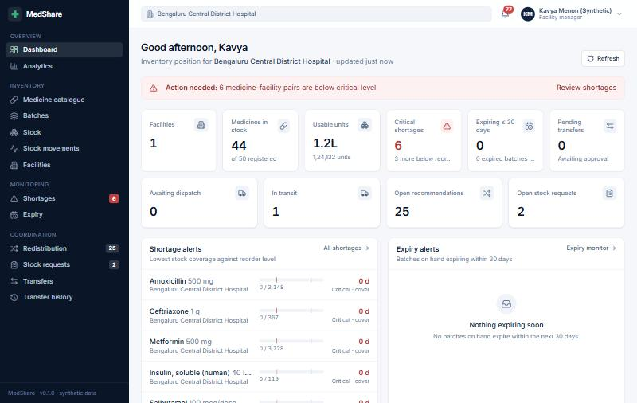
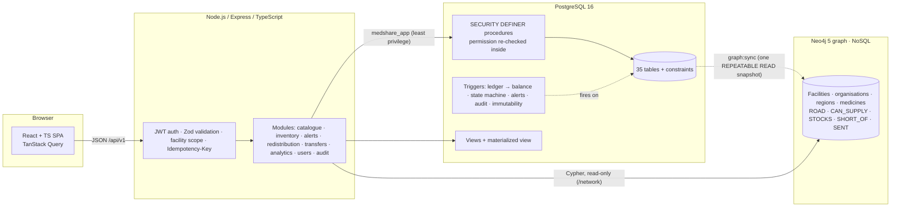
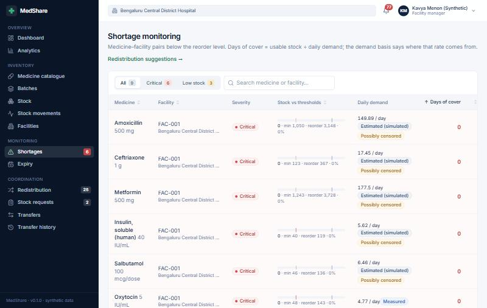
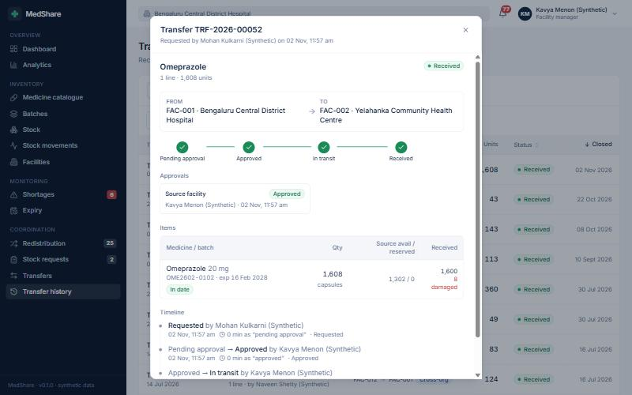
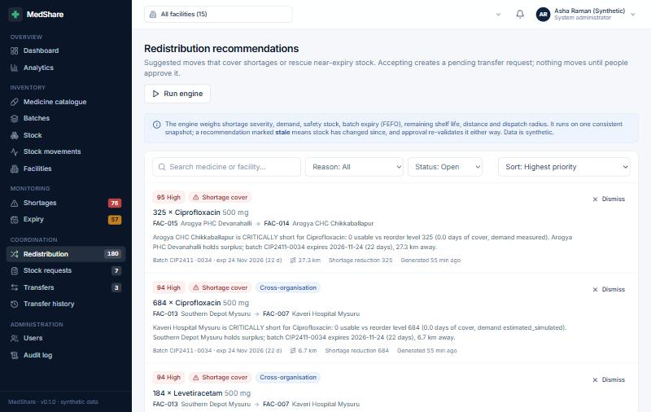
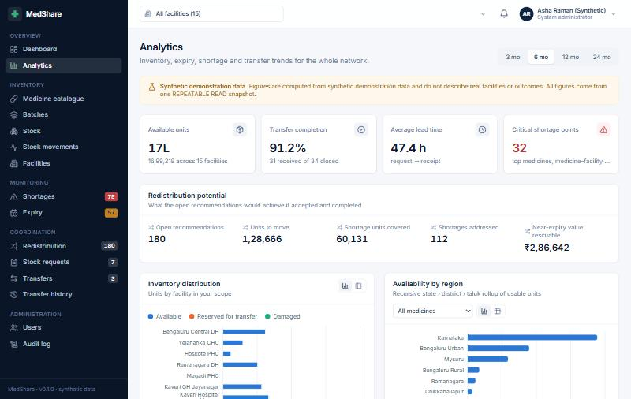

# MedShare

**An intelligent medicine-inventory coordination platform for healthcare facilities: a university DBMS project.**

MedShare lets participating facilities see medicine shortages, excess stock and near-expiry batches across their network, and move stock between facilities through an audited request → approve → dispatch → receive workflow. A PostgreSQL database is the foundation. Stock balances, reservations, permissions and the transfer state machine are all enforced inside the database, not only in application code.

> **Simulated platform, synthetic data.** MedShare does not connect to any real hospital, pharmacy or government system. Every organisation, facility, user, manufacturer and figure in the seed is synthetic and labelled "(Synthetic)". Transfers always need human approval, and real-world use would need institutional authorisation and regulatory validation.



---

## 1. Problem

Public and private facilities in the same district routinely hold the wrong stock at the same time. One hospital runs out of an essential antibiotic while a pharmacy 20 km away holds a surplus that will expire next month. The information exists in separate stock registers, so nobody sees the match until it is too late: the patient goes without, and the surplus is written off.

## 2. Objectives

1. **One consistent view of stock**: batch-level inventory per facility, with available, reserved and damaged quantities that can never go negative or drift from their history.
2. **Early warning**: shortages (days of cover from measured or estimated demand) and expiry (7 / 30 / 60-day windows) detected automatically.
3. **Redistribution recommendations** that pair shortages with surplus and near-expiry stock using demand, safety stock, FEFO, distance, dispatch radius and cold chain. They are **advisory only**; nothing moves without approval.
4. **A safe transfer workflow**: atomic reservation at approval, no double allocation under concurrency, segregation of duties, an organisation-level stage for cross-organisation transfers, and idempotent retries.
5. **Accountability**: an append-only movement ledger and audit log, least-privilege database roles, and per-facility access scope.
6. **Demonstrate DBMS concepts** end to end: normalised design (3NF/BCNF), constraints, triggers, procedures, views, indexes, transactions and isolation, and analytical SQL.

## 3. Technology

| Layer | Stack |
|---|---|
| Database | PostgreSQL 16 (Docker): PL/pgSQL procedures and triggers, views and a materialized view, GIN trigram, BRIN, partial and covering indexes, exclusion constraint |
| Graph database (NoSQL) | Neo4j 5 Community (Docker), Cypher: a read model of the facility network (distances, legal supply links, stock, shortages, delivery corridors), rebuilt from PostgreSQL |
| Backend | Node.js 20+, Express, TypeScript, Zod, JWT (HS256), bcrypt, `pg` for SQL, Prisma as an introspected typed client |
| Frontend | React 18, TypeScript, Vite, Tailwind CSS 4, TanStack Query, React Router, React Hook Form + Zod, Recharts |
| Tests | PostgreSQL SQL checks, multi-connection concurrency tests, Vitest + Supertest API tests against real PostgreSQL, Vitest + Testing Library frontend tests |

## 4. Architecture



* The API connects as `medshare_app`, which **cannot write** inventory, the ledger or transfers directly. It calls `SECURITY DEFINER` routines that re-check the caller's permission in the database.
* Inventory balances change **only** through the `inventory_movements` ledger trigger. A reconciliation function proves balances = Σ ledger deltas (0 discrepancies after every test run).
* PostgreSQL is the system of record. **Neo4j** holds a read-only graph of the facility network, rebuilt from one PostgreSQL snapshot; it answers path and neighbourhood questions for the Network map ([`DBMS_DOCUMENTATION.md` §15](DBMS_DOCUMENTATION.md#15-nosql-the-graph-database-neo4j)).
* The frontend only presents. Buttons for transfer actions come from the server's `allowedActions`, and every write is still re-validated in the database.

Detailed design: [`backend/docs/PHASE1_DATABASE_DESIGN.md`](backend/docs/PHASE1_DATABASE_DESIGN.md) · implementation: [`backend/docs/PHASE2_IMPLEMENTATION.md`](backend/docs/PHASE2_IMPLEMENTATION.md) · frontend: [`frontend/docs/FRONTEND_ARCHITECTURE.md`](frontend/docs/FRONTEND_ARCHITECTURE.md).

## 5. Installation

Prerequisites: **Docker Desktop** (running) and **Node.js 20+**.

```bash
cp .env.example .env            # placeholders work locally; change passwords and JWT_SECRET for anything shared

cd backend
npm install
npm run db:up                   # PostgreSQL 16 on :5433 and Neo4j 5 on :7474/:7687 (containers medshare-postgres, medshare-neo4j)
npm run db:reset                # migrations 000–009 + deterministic synthetic seed + graph rebuild (~25 s)
npm run dev                     # API → http://localhost:4000/api/v1

# in a second terminal
cd frontend
npm install
npm run dev                     # http://localhost:5173 (proxies /api to :4000)
```

Sign in with a synthetic demo account (password `MedShare@2026`). In development builds the sign-in page lists them for one-click use.

| Account | Role |
|---|---|
| `admin@medshare.health` | System administrator (users, batches, audit; cannot approve transfers) |
| `auditor@medshare.health` | Platform auditor (read-only) |
| `org1.admin@medshare.health` … `org5.admin@…` | Organisation administrator |
| `fac-001.manager@medshare.health` … `fac-015.manager@…` | Facility manager |
| `fac-001.inventory@medshare.health` … `fac-015.inventory@…` | Inventory manager |

## 6. Environment

All configuration is in the root `.env` (git-ignored; template `.env.example`).

| Variable | Purpose |
|---|---|
| `POSTGRES_ADMIN_USER`, `POSTGRES_ADMIN_PASSWORD`, `POSTGRES_PORT` | Database container superuser and host port (5433) |
| `NEO4J_PASSWORD`, `NEO4J_HTTP_PORT`, `NEO4J_BOLT_PORT` | Graph database container password (user `neo4j`) and host ports (7474 browser, 7687 Bolt) |
| `NEO4J_URL`, `NEO4J_USER` | How the API reaches Neo4j; without `NEO4J_URL` the `/network` endpoints answer 503 and everything else still works |
| `DATABASE_ADMIN_URL` | Superuser connection, used only by migrations, seed, tests and the perf study |
| `MEDSHARE_APP_PASSWORD`, `DATABASE_URL` | The least-privilege `medshare_app` role the API uses |
| `JWT_SECRET`, `JWT_EXPIRES_IN` | Token signing (≥ 32 random characters) and lifetime |
| `PORT`, `CORS_ORIGIN` | API port; allowed browser origin |
| `JOBS_ENABLED` | Run the expiry, shortage, recommendation, analytics and graph-sync jobs daily in the API process |

The frontend's optional `frontend/.env.local` sets `VITE_API_BASE_URL` and `VITE_PROXY_TARGET` (defaults work).

## 7. API

REST, JSON, `/api/v1`, bearer-token auth, `{ data, meta }` pagination, `Idempotency-Key` on stock and transfer writes, and a uniform error body. **[`API_CONTRACT.md`](API_CONTRACT.md)** documents every endpoint, request, response, error code and authorisation rule, with the changes made after approval in §4.

## 8. Database schema

35 tables in 3NF. Every determinant is a candidate key (BCNF), with the few deliberate exceptions documented. The schema is SQL-first: hand-written, checksummed migrations in [`backend/db/migrations`](backend/db/migrations).

| Migration | Contents |
|---|---|
| `000_bootstrap` | Roles, schema ownership, timezone |
| `001_schema` | Types, tables, keys, CHECK / UNIQUE / exclusion constraints, indexes, data dictionary comments |
| `002_core` | Event clock, RBAC data and permission function, partner authorisation, distance, idempotency, audit helpers |
| `003_triggers` | Ledger → balance, state machine, alerts, audit, append-only and integrity triggers |
| `004_procedures` | Transfer workflow, ledger entry points, stock requests, reconciliation, jobs, redistribution engine |
| `005_views` | Recursive trees, inventory detail, demand, shortage status, timeline (`LAG`/`LEAD`), analytics, materialized monthly consumption |
| `006_privileges`, `007_trigger_security` | Least-privilege grants; SECURITY DEFINER trigger functions |
| `008_idempotent_stock_actions` | Exactly-once dispense / damage / dispose / write-off / adjust |
| `009_query_performance` | `fn_today()` STABLE and view rewrites justified by the EXPLAIN study |

Data dictionary, functional dependencies and normalisation: [`backend/docs/PHASE1_DATABASE_DESIGN.md` §5–7](backend/docs/PHASE1_DATABASE_DESIGN.md). Everything DBMS-related in one place: **[`DBMS_DOCUMENTATION.md`](DBMS_DOCUMENTATION.md)**.

### Graph database (NoSQL)

Neo4j holds the facility network as a graph: 88 nodes and 928 relationships on the seed. `npm run graph:sync` rebuilds it from PostgreSQL (also done by `db:reset` and the **Sync from PostgreSQL** button), and `npm run graph:queries` runs the 18 documented Cypher queries in [`backend/db/graph/queries.cypher`](backend/db/graph/queries.cypher). Explore it visually inside the app: **Network map → Query explorer (Cypher)**, for the admin and platform auditor, runs read-only Cypher and draws the result as a graph. Neo4j Browser at http://localhost:7474 (user `neo4j`, password `NEO4J_PASSWORD`) also works. Model, sync design and a SQL-vs-Cypher comparison: [`DBMS_DOCUMENTATION.md` §15](DBMS_DOCUMENTATION.md#15-nosql-the-graph-database-neo4j).

## 9. ER diagram

The entity-relationship diagram (crow's foot, Mermaid) is in **[`ER_DIAGRAM.md`](ER_DIAGRAM.md)**. In summary: organisations operate facilities in a recursive region tree; medicines (composed of substances) are produced as global batches; `inventory` resolves facility × batch and carries the balances; every change is an `inventory_movements` row; transfers have lines, per-stage approvals and a status history; stock requests link to transfer lines through fulfilments.

## 10. Screenshots

| | |
|---|---|
|  Shortages with demand basis (measured vs estimated, possibly censored) |  A received transfer: stages, items with 8 units damaged in transit, LAG timeline |
|  Explainable, prioritised recommendations |  Analytics from one REPEATABLE READ snapshot, labelled synthetic |

## 11. Testing

| Suite | Command | Count |
|---|---|---|
| SQL integrity checks (rolled back) | `cd backend && npm run db:test` | 77 |
| Multi-connection concurrency (races, isolation, deadlock retry, least privilege) | `npm run db:test` | 22 |
| API integration tests against real PostgreSQL and Neo4j | `npm test` | 66 |
| Frontend unit and component tests | `cd frontend && npm test` | 27 |
| SQL query catalogue (24 queries, read-only as `medshare_app`) | `cd backend && npm run db:queries` | 24 |
| Cypher query catalogue (graph database) | `npm run graph:queries` | 18 |
| Performance study (scaled data, EXPLAIN before/after) | `npm run perf:build && npm run perf:explain` | 4 query families |

The headline concurrency test: facility A holds 150 units, and two transfers of 100 are approved simultaneously. Exactly one succeeds; the other gets `INSUFFICIENT_STOCK` and stays PENDING, and reconciliation reports 0 discrepancies. See [`DBMS_DOCUMENTATION.md` §12](DBMS_DOCUMENTATION.md) and [`backend/docs/PHASE5_TESTING_AND_OPTIMISATION.md`](backend/docs/PHASE5_TESTING_AND_OPTIMISATION.md).

## 12. Demonstration

A 15-minute guided walkthrough for a university demonstration is in **[`docs/DEMO_WALKTHROUGH.md`](docs/DEMO_WALKTHROUGH.md)**.

## Repository layout

```
MedShare/
├── API_CONTRACT.md · DBMS_DOCUMENTATION.md · ER_DIAGRAM.md · README.md
├── docker-compose.yml · .env.example
├── backend/     PostgreSQL migrations, seed, SQL tests, perf study, Neo4j sync and Cypher queries, Express API, API tests, design docs
├── frontend/    React app, component tests, frontend docs
└── docs/        demo walkthrough, screenshots
```
