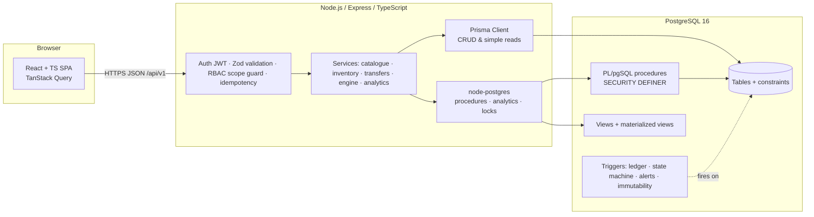

# MedShare — Phase 1: Requirements & Database Design

**Status:** Approved and implemented in Phase 2. [PHASE2_IMPLEMENTATION.md](PHASE2_IMPLEMENTATION.md) lists what was built and where implementation refined this design (its §7).
**Schema:** [`backend/db/schema.phase1.sql`](../db/schema.phase1.sql) is the Phase 1 snapshot; the live schema is in [`backend/db/migrations/`](../db/migrations/). The Phase 1 snapshot was validated on PostgreSQL 16: it applies cleanly (35 tables, 100 indexes). 15 deliberately invalid writes were each rejected by the intended constraint:

* negative balances
* duplicate inventory row
* zero quantity or unknown movement type
* expiry before manufacture
* quarantine without a reason
* duplicate batch
* overlapping or un-canonical agreements
* inverted thresholds
* self-transfer
* a second open shortage alert
* a non-bcrypt password hash
* a second config row

The derived queries (region level by recursive CTE, composed strength label, ledger-derived balances) were also run. *Not yet verified:* "REJECTED requires a reason" (that probe had a syntax error); Phase 2's test script covers it.

> MedShare is a **simulated** institutional inventory-coordination platform. It has no access to real hospital, pharmacy or government systems, and it does not execute physical transfers. Every transfer requires authorised human approval, and real-world use would need institutional authorisation and regulatory validation. All seed data is synthetic and flagged `is_synthetic`.

---

## Contents

1. [Requirements specification](#1-requirements-specification)
2. [System architecture](#2-system-architecture)
3. [Entity identification](#3-entity-identification)
4. [ER diagram](#4-er-diagram)
5. [Relational schema & data dictionary](#5-relational-schema--data-dictionary)
6. [Functional dependencies](#6-functional-dependencies)
7. [Normalization analysis (1NF → BCNF)](#7-normalization-analysis)
8. [Key design decisions and alternatives](#8-key-design-decisions-and-alternatives)
9. [Transaction & concurrency design](#9-transaction--concurrency-design)
10. [Redistribution engine design](#10-redistribution-engine-design)
11. [Planned procedures, triggers, views, indexes](#11-planned-procedures-triggers-views-and-indexes)
12. [Design review: anomalies, concurrency risks, compromises](#12-design-review)
13. [Why PostgreSQL](#13-why-postgresql)
14. [Impact on the existing frontend](#14-impact-on-the-existing-frontend)
15. [Phase 2 plan and decisions needing approval](#15-phase-2-plan-and-decisions-needing-approval)

---

## 1. Requirements specification

### 1.1 Actors

| Role | Scope | Purpose |
|---|---|---|
| **System administrator** | Platform | Manages organisations, agreements, platform users and reference data. Deliberately **not** an operational approver (segregation of duties). |
| **Organisation administrator** | One organisation | Manages the organisation's facilities and users; gives the organisation-level approval for cross-organisation transfers. |
| **Facility manager** | One or more facilities | Configures stock policy, approves outgoing transfers, and performs all inventory-manager operations. |
| **Inventory manager** | One or more facilities | Receives stock, records dispensing and damage, raises requests, dispatches and receives transfers. |
| **Auditor** | Platform or organisation | Reads everything in scope, including audit logs; cannot modify anything. |

### 1.2 Functional requirements

| ID | Requirement |
|---|---|
| **FR-1 Identity** | Email/password login (bcrypt) issuing a JWT. Users can hold several roles at different scopes. Accounts are deactivated, never deleted. |
| **FR-2 Authorisation** | Every request is authorised on the backend against role, scope and permission. Facility IDs from the client are never trusted. Inventory-changing procedures re-check permission inside the database. |
| **FR-3 Organisations & facilities** | CRUD for organisations, facilities (with coordinates, cold-chain capability and dispatch radius) and inter-organisation transfer agreements with validity periods. |
| **FR-4 Medicine catalogue** | Add and edit medicines; categorise them (hierarchical categories); search by name, substance, manufacturer and category; show composition (multi-ingredient), form, unit, cold-chain need and essential-medicine flag. |
| **FR-5 Batches** | A batch has a batch number, medicine, manufacturer, manufacture and expiry dates, unit acquisition cost, and status (`ACTIVE` / `QUARANTINED` / `RECALLED`). "Expired" is computed from the date, never stored. |
| **FR-6 Inventory** | Per (facility, batch): available, reserved and damaged quantities, plus last-updated. All three must be ≥ 0. Changes happen only through movements; there are no arbitrary updates. |
| **FR-7 Movement ledger** | Every change is an append-only movement: receipt, dispense, reserve, release, transfer out/in, transit damage, damage, disposal, expiry write-off, or adjustment. Movements are never edited or deleted. |
| **FR-8 Stock policy** | Per (facility, medicine): minimum stock level, reorder threshold, safety stock, and estimated daily consumption, flagged as simulated or configured. |
| **FR-9 Shortage detection** | Days of inventory = usable stock ÷ daily demand. Measured demand (from dispensing history) is used when there's enough history; otherwise the estimate is used and labelled as such. CRITICAL below the minimum level, LOW below the reorder threshold. Alerts are generated and resolved automatically. |
| **FR-10 Expiry monitoring** | Buckets: expired, ≤ 7, ≤ 30, ≤ 60 days, healthy. Scheduled alert generation. Expired stock can never be reserved or transferred. Expiry write-off is supported. |
| **FR-11 Redistribution engine** | Finds shortages, surpluses and near-expiry excess. Matches them on medicine, FEFO batch order, quantity, destination demand, distance, transport feasibility (radius, cold chain) and authorisation (same organisation or an active agreement). Each recommendation shows source, destination, medicine, batch, quantity, expiry, reason, distance and potential shortage reduction. It **never executes** a transfer. |
| **FR-12 Stock requests** | A destination raises a multi-line request (medicine + quantity, priority, needed-by date). Fulfilment is derived from linked transfer items. |
| **FR-13 Transfers** | Multi-item, batch-level transfers with the state machine `PENDING → APPROVED → DISPATCHED → RECEIVED` (or `REJECTED` / `CANCELLED`). Approval by the source facility manager, plus organisation approval when the transfer crosses organisations. Stock is reserved at approval, deducted at dispatch, and added at receipt (with transit damage). Full status history. |
| **FR-14 Transactions** | Approve, dispatch, receive, reject and cancel are each a single ACID transaction with row-level locks. Each supports an idempotency key. |
| **FR-15 Alerts & notifications** | Shortage and expiry alerts (open / acknowledged / resolved); per-user notifications. |
| **FR-16 Audit** | Append-only audit log: actor, action, entity, entity ID, facility, timestamp, old/new values. It can't be changed through normal application operations. |
| **FR-17 Analytics** | SQL analytics: stock across facilities, availability by region (hierarchical rollup), recurring shortages, expiry risk, redistribution potential, transfer completion rate, wastage estimate and monthly consumption. Simulated figures are labelled. |
| **FR-18 Reconciliation** | A procedure that proves each inventory balance equals its ledger sum and each reserved quantity equals the open approved transfer items. |

### 1.3 Non-functional requirements

| ID | Requirement |
|---|---|
| NFR-1 Integrity | Constraints in the database are the last line of defence; no business rule relies on the frontend alone. |
| NFR-2 Consistency under concurrency | No double allocation, negative stock, duplicate processing or partially applied transfer, under any interleaving. |
| NFR-3 Auditability | Every stock change is traceable to a movement, an actor and a reason or transfer. |
| NFR-4 Performance | Common screens under 200 ms on the seed dataset; analytics under 1 s. Shown with `EXPLAIN ANALYZE`. |
| NFR-5 Security | bcrypt password hashing, JWT secrets from the environment, least-privilege database roles, parameterised SQL only. |
| NFR-6 Reproducibility | Docker Compose for PostgreSQL; deterministic seed; integration tests against real PostgreSQL (never SQLite). |
| NFR-7 Maintainability | TypeScript throughout; modular services; SQL migrations under version control. |

### 1.4 Assumptions and out of scope

* Quantities are integers in the medicine's issue unit (tablet, vial, bottle…). Pack conversions are out of scope.
* One timezone (`Asia/Kolkata`); expiry is compared on calendar dates.
* Distance is great-circle distance × 1.3, a road-distance approximation. There is no routing API.
* There's no procurement, billing, patient records or prescriptions. Dispensing is recorded only as aggregate consumption.
* Notifications are in-app only; there's no email or SMS.

---

## 2. System architecture



| Layer | Responsibility |
|---|---|
| **Frontend** | Presentation only. It never computes stock or decides permissions; it hides controls for UX, and the backend decides. |
| **API middleware** | JWT verification, Zod validation of every body and query, resolution of the user's **effective facility scope** from the database, and idempotency-key handling. |
| **Services** | Orchestrate use cases. Stock-changing operations go through a database procedure, so the integrity logic lives next to the data. |
| **Prisma** | Typed access for master data CRUD and simple reads (users, facilities, medicines, settings). |
| **Raw SQL (`pg`)** | Procedure calls, `SELECT … FOR UPDATE` demonstrations, analytics (CTEs, window functions, recursive CTEs), `EXPLAIN ANALYZE`. |
| **Database** | Constraints, ledger trigger, state-machine trigger, procedures, views, least-privilege roles. |

**Database roles (least privilege):**

| DB role | Privileges |
|---|---|
| `medshare_owner` | Owns all objects; runs migrations. Not used by the API. |
| `medshare_app` | API login. `SELECT` on tables and views; `INSERT`/`UPDATE` on master data, requests and notifications; `INSERT` only on `audit_logs`; **no** `INSERT`/`UPDATE`/`DELETE` on `inventory`, `inventory_movements` or `transfer_*`. Those change only via `EXECUTE` on `SECURITY DEFINER` procedures. |
| `medshare_readonly` | `SELECT` on views, for reporting and auditor tooling. |

**Schema ownership — SQL-first.** The DDL, procedures, triggers and views are hand-written SQL migrations (`backend/db/migrations/NNN_*.sql`) applied by a small runner that records them in a `schema_migrations` table. `schema.prisma` is generated by `prisma db pull`.
*Alternative considered:* Prisma Migrate as the source of truth. It was rejected because Prisma can't express exclusion constraints, partial unique indexes with `NULLS NOT DISTINCT`, CHECKs across columns, triggers, procedures or BRIN/trigram indexes, so the schema's most important integrity features would live outside its model anyway.

---

## 3. Entity identification

| Entity / relation | Kind | Identified from |
|---|---|---|
| User | Strong | Login, actors |
| Role, Permission | Strong (reference) | RBAC |
| RolePermission | Associative M:N | Role ↔ Permission |
| UserRole | Associative (user, role, optional org) | Platform/organisation grants |
| FacilityUser | Associative (user, facility, role) | Facility assignment |
| Organization | Strong | Participating institutions |
| OrganizationAgreement | Associative with attributes (period) | Cross-organisation authorisation |
| Region | Strong, recursive (state > district > taluk) | Analytics by region |
| Facility | Strong | Inventory holders |
| MedicineCategory | Strong, recursive | Catalogue classification |
| MedicineUnit | Strong (reference) | Issue unit |
| Substance | Strong (reference) | Active ingredients |
| Medicine | Strong | Catalogue |
| MedicineIngredient | Associative M:N with attributes (strength) | Composition |
| Manufacturer | Strong | Batch provenance |
| MedicineBatch | Strong | Physical lot (expiry independent of medicine) |
| Inventory | Associative (facility × batch) with balances | Stock per site |
| FacilityMedicineSetting | Associative (facility × medicine) with policy | Thresholds, demand estimate |
| EngineConfig | Singleton | Configurable thresholds |
| MovementType | Reference | Effect of each movement on balances |
| InventoryMovement | Event (append-only) | Ledger |
| StockRequest, StockRequestItem | Strong + weak (lines) | Destination demand |
| RedistributionRecommendation | Event snapshot | Engine output |
| TransferRequest, TransferItem | Strong + weak (lines) | Transfers |
| StockRequestFulfilment | Associative | Request line ↔ transfer line |
| TransferApproval | Weak (per stage) | Authorisation |
| TransferStatusHistory | Event (append-only) | Lifecycle |
| ExpiryAlert, ShortageAlert | Event with lifecycle | Monitoring |
| Notification | Event | In-app messages |
| AuditLog | Event (append-only) | Accountability |
| IdempotencyKey | Technical | Exactly-once API |

**Mandated tables → schema:** all 21 required tables are present with the required names.
The 14 additional tables are `permissions`, `role_permissions`, `regions`, `organization_agreements`, `manufacturers`, `substances`, `medicine_ingredients`, `facility_medicine_settings`, `engine_config`, `movement_types`, `redistribution_recommendations`, `stock_request_fulfilments`, `transfer_status_history` and `idempotency_keys`. Each one exists because normalization or a requirement demanded it (§7, §8).

---

## 4. ER diagram

Crow's-foot notation (Mermaid). Attributes are abbreviated to keys and the most important columns; the full list is in §5 and `migrations/001_schema.sql`.

```mermaid
erDiagram
  USERS ||--o{ USER_ROLES : holds
  ROLES ||--o{ USER_ROLES : granted_as
  ORGANIZATIONS |o--o{ USER_ROLES : scopes
  USERS ||--o{ FACILITY_USERS : assigned
  FACILITIES ||--o{ FACILITY_USERS : staffed_by
  ROLES ||--o{ FACILITY_USERS : as_role
  ROLES ||--o{ ROLE_PERMISSIONS : has
  PERMISSIONS ||--o{ ROLE_PERMISSIONS : granted_by

  ORGANIZATIONS ||--o{ FACILITIES : operates
  REGIONS ||--o{ FACILITIES : located_in
  REGIONS |o--o{ REGIONS : parent_of
  ORGANIZATIONS ||--o{ ORGANIZATION_AGREEMENTS : party_a
  ORGANIZATIONS ||--o{ ORGANIZATION_AGREEMENTS : party_b

  MEDICINE_CATEGORIES |o--o{ MEDICINE_CATEGORIES : parent_of
  MEDICINE_CATEGORIES ||--o{ MEDICINES : classifies
  MEDICINE_UNITS ||--o{ MEDICINES : dispensed_in
  MEDICINES ||--|{ MEDICINE_INGREDIENTS : composed_of
  SUBSTANCES ||--o{ MEDICINE_INGREDIENTS : appears_in
  MEDICINES ||--o{ MEDICINE_BATCHES : produced_as
  MANUFACTURERS ||--o{ MEDICINE_BATCHES : makes

  FACILITIES ||--o{ INVENTORY : holds
  MEDICINE_BATCHES ||--o{ INVENTORY : stocked_as
  INVENTORY ||--o{ INVENTORY_MOVEMENTS : changed_by
  MOVEMENT_TYPES ||--o{ INVENTORY_MOVEMENTS : typed_as
  USERS ||--o{ INVENTORY_MOVEMENTS : performed
  FACILITIES ||--o{ FACILITY_MEDICINE_SETTINGS : configures
  MEDICINES ||--o{ FACILITY_MEDICINE_SETTINGS : policy_for

  FACILITIES ||--o{ STOCK_REQUESTS : raises
  STOCK_REQUESTS ||--|{ STOCK_REQUEST_ITEMS : lines
  MEDICINES ||--o{ STOCK_REQUEST_ITEMS : requested

  INVENTORY ||--o{ REDISTRIBUTION_RECOMMENDATIONS : source
  FACILITIES ||--o{ REDISTRIBUTION_RECOMMENDATIONS : destination
  REDISTRIBUTION_RECOMMENDATIONS |o--o| TRANSFER_REQUESTS : accepted_as

  FACILITIES ||--o{ TRANSFER_REQUESTS : source
  FACILITIES ||--o{ TRANSFER_REQUESTS : destination
  TRANSFER_REQUESTS ||--|{ TRANSFER_ITEMS : contains
  MEDICINE_BATCHES ||--o{ TRANSFER_ITEMS : of_batch
  TRANSFER_ITEMS ||--o| STOCK_REQUEST_FULFILMENTS : fulfils
  STOCK_REQUEST_ITEMS ||--o{ STOCK_REQUEST_FULFILMENTS : fulfilled_by
  TRANSFER_REQUESTS ||--o{ TRANSFER_APPROVALS : approved_by
  TRANSFER_REQUESTS ||--|{ TRANSFER_STATUS_HISTORY : history
  TRANSFER_ITEMS ||--o{ INVENTORY_MOVEMENTS : realised_by

  INVENTORY ||--o{ EXPIRY_ALERTS : flags
  FACILITY_MEDICINE_SETTINGS ||--o{ SHORTAGE_ALERTS : breaches
  USERS ||--o{ NOTIFICATIONS : receives
  USERS |o--o{ AUDIT_LOGS : acted
  USERS ||--o{ IDEMPOTENCY_KEYS : issued
```



**Cardinality notes**
* A batch is one physical lot and may be held by many facilities (one inventory row each). A facility holds many batches. `inventory` resolves this M:N relationship and carries the balances.
* A medicine has one or more ingredients (`||--|{`), so combination products are first-class.
* A recommendation is accepted into at most one transfer (`recommendation_id UNIQUE`).
* A transfer item fulfils at most one stock-request line (PK on `transfer_item_id`); a request line may be fulfilled by many items from different sources.

---

## 5. Relational schema & data dictionary

Notation: **PK** in bold, *FK* in italics → referenced table, `CK` = other candidate keys. ON DELETE is RESTRICT unless stated otherwise: history must never disappear through a cascade.

| Relation | Attributes | Keys & constraints | Purpose |
|---|---|---|---|
| `users` | **id**, email, password_hash, full_name, is_active, is_synthetic, last_login_at, created_at, updated_at | CK email (citext); bcrypt-format check | Accounts |
| `roles` | **id**, code, name, grant_level, description | CK code, CK name | The 5 roles; `grant_level` says where a role may be granted |
| `permissions` | **code**, description | — | Fine-grained actions (`transfer:approve`, …) |
| `role_permissions` | ***role_id***, ***permission_code*** | PK both; CASCADE (pure association) | RBAC matrix as data |
| `user_roles` | **id**, *user_id*, *role_id*, *organization_id*?, *granted_by*, granted_at | CK (user_id, role_id, organization_id) `NULLS NOT DISTINCT` | Platform (org NULL) or organisation grants |
| `facility_users` | ***user_id***, ***facility_id***, ***role_id***, *assigned_by*, assigned_at | PK triple | Facility-scoped roles |
| `regions` | **id**, *parent_id*?, code, name | CK code; CK (parent_id, name) | State > district > taluk tree; level = depth |
| `organizations` | **id**, name, org_type, registration_number, contact_email, is_active, is_synthetic, timestamps | CK name, CK registration_number | Participating institutions |
| `organization_agreements` | **id**, *organization_a_id*, *organization_b_id*, valid_from, valid_to?, *created_by*, created_at | a < b; `EXCLUDE` overlapping periods per pair | Cross-organisation authorisation |
| `facilities` | **id**, *organization_id*, *region_id*, code, name, facility_type, address_line, latitude, longitude, has_cold_chain, max_dispatch_radius_km, contact_phone, is_active, is_synthetic, timestamps | CK code; CK (organization_id, name); coordinate range checks | Inventory-holding sites |
| `medicine_categories` | **id**, *parent_id*?, name, description | CK (parent_id, name) | Hierarchical therapeutic classes |
| `medicine_units` | **id**, code, name | CK code, CK name | Issue units |
| `substances` | **id**, name | CK name | Active ingredients (INN) |
| `medicines` | **id**, code, name, dosage_form, unit_volume_ml?, *category_id*, *dispensing_unit_id*, requires_cold_chain, is_essential, description, is_active, timestamps | CK code; composition uniqueness by trigger | Product definition |
| `medicine_ingredients` | ***medicine_id***, ***substance_id***, strength_value, strength_uom | PK pair; CASCADE from medicine (composition) | Strength per ingredient |
| `manufacturers` | **id**, name, license_number, country, is_synthetic | CK name, CK license_number | Batch provenance |
| `medicine_batches` | **id**, *medicine_id*, *manufacturer_id*, batch_number, manufacture_date, expiry_date, unit_cost, status, status_reason, timestamps | CK (manufacturer_id, medicine_id, batch_number); expiry > manufacture; non-ACTIVE needs reason | Physical lot |
| `inventory` | **id**, *facility_id*, *batch_id*, qty_available, qty_reserved, qty_damaged, updated_at | CK (facility_id, batch_id); all qty ≥ 0 | Current balance (ledger-maintained) |
| `facility_medicine_settings` | ***facility_id***, ***medicine_id***, min_stock_level, reorder_threshold, safety_stock, estimated_daily_consumption, estimate_is_simulated, *updated_by*, updated_at | min ≤ reorder; safety ≤ reorder | Stock policy & demand estimate |
| `engine_config` | **id** (= true), planning_horizon_days, min_remaining_shelf_life_days, near_expiry_window_days, measured_demand_min_history_days, large_adjustment_audit_units, *updated_by*, updated_at | singleton via CHECK(id) | Configurable thresholds |
| `movement_types` | **code**, effect_available, effect_reserved, effect_damaged, requires_transfer_item, requires_reason, description | effects ∈ {−1, 0, 1}, not all 0 | Effect of each movement type, stated once |
| `inventory_movements` | **id**, *inventory_id*, *movement_type*, quantity, *transfer_item_id*?, reason, reference, *performed_by*, created_at | quantity > 0 | Append-only ledger |
| `stock_requests` | **id**, code, *requesting_facility_id*, *requested_by*, priority, status, needed_by, notes, timestamps, closed_at | CK code; OPEN ⇔ closed_at NULL | Destination demand |
| `stock_request_items` | **id**, *stock_request_id*, *medicine_id*, quantity_requested | CK (stock_request_id, medicine_id); CASCADE from request | Request lines |
| `redistribution_recommendations` | **id**, generated_at, reason_code, *source_inventory_id*, *destination_facility_id*, recommended_quantity, projected_shortage_reduction, priority_score, explanation, status, *status_changed_by*, status_changed_at | reduction ≤ quantity; one OPEN per (source_inventory, destination) | Engine snapshot |
| `transfer_requests` | **id**, code, *source_facility_id*, *destination_facility_id*, *recommendation_id*?, status, *requested_by*, request_notes, rejection_reason, timestamps | CK code; CK recommendation_id; source ≠ destination; REJECTED needs a reason | Transfer header |
| `transfer_items` | **id**, *transfer_id*, *batch_id*, quantity, quantity_received?, quantity_damaged_in_transit? | CK (transfer_id, batch_id); received + damaged = quantity | Transfer lines |
| `stock_request_fulfilments` | ***transfer_item_id***, *stock_request_item_id* | PK transfer_item_id | Line-level fulfilment link |
| `transfer_approvals` | **id**, *transfer_id*, stage, decision, *decided_by*, comment, decided_at | CK (transfer_id, stage); rejection needs a comment | Approval per stage |
| `transfer_status_history` | **id**, *transfer_id*, to_status, *changed_by*, note, changed_at | — | Lifecycle (previous status via `LAG`) |
| `expiry_alerts` | **id**, *inventory_id*, level, status, quantity_at_detection, detected_at, *acknowledged_by*, acknowledged_at, resolved_at | one unresolved per (inventory, level) | Expiry monitoring |
| `shortage_alerts` | **id**, *(facility_id, medicine_id)* → settings, severity, status, stock_at_detection, threshold_at_detection, detected_at, *acknowledged_by*, acknowledged_at, resolved_at | one unresolved per (facility, medicine) | Shortage monitoring |
| `notifications` | **id**, *recipient_user_id*, category, title, body, entity_type, entity_id, created_at, read_at | CASCADE from user | In-app inbox |
| `audit_logs` | **id**, occurred_at, *actor_user_id*?, action, entity_type, entity_id, *facility_id*?, old_values, new_values, request_id, ip_address | append-only | Accountability |
| `idempotency_keys` | ***user_id***, **idem_key**, operation, request_hash, resource_type, resource_id, created_at | PK (user_id, idem_key) | Exactly-once API operations |

Column types, domains and CHECK details are in [`migrations/001_schema.sql`](../db/migrations/001_schema.sql), the authoritative data dictionary. It also carries `COMMENT ON` for every table and for the non-obvious columns, so `\d+` shows the dictionary in-database.

---

## 6. Functional dependencies

For every relation, the non-trivial FDs are listed below. The determinant of every FD is a superkey, which is the BCNF condition. "→ *" means "determines all other attributes".

| Relation | Functional dependencies | Determinants are keys? |
|---|---|---|
| users | id → \*; email → \* | ✔ |
| roles | id → \*; code → \*; name → \* | ✔ |
| permissions | code → description | ✔ |
| role_permissions | (none; all-key) | ✔ |
| user_roles | id → \*; (user_id, role_id, organization_id) → granted_by, granted_at, id | ✔ |
| facility_users | (user_id, facility_id, role_id) → assigned_by, assigned_at | ✔ |
| regions | id → parent_id, code, name; code → \*; (parent_id, name) → \* | ✔ (level removed, see §7.4) |
| organizations | id → \*; name → \*; registration_number → \* | ✔ |
| organization_agreements | id → \*; (a, b, valid_from) → \* | ✔ |
| facilities | id → \*; code → \*; (organization_id, name) → \* | ✔ |
| medicine_categories | id → \*; (parent_id, name) → \* | ✔ |
| medicine_units | id → \*; code → \*; name → \* | ✔ |
| substances | id → name; name → id | ✔ |
| medicines | id → \*; code → \* | ✔ |
| medicine_ingredients | (medicine_id, substance_id) → strength_value, strength_uom | ✔ |
| manufacturers | id → \*; name → \*; license_number → \* | ✔ |
| medicine_batches | id → \*; (manufacturer_id, medicine_id, batch_number) → \* | ✔ |
| inventory | id → \*; (facility_id, batch_id) → \* | ✔ |
| facility_medicine_settings | (facility_id, medicine_id) → \* | ✔ |
| engine_config | id → \* (single row) | ✔ |
| movement_types | code → effect_\*, requires_\*, description | ✔ |
| inventory_movements | id → \* | ✔ |
| stock_requests | id → \*; code → \* | ✔ |
| stock_request_items | id → \*; (stock_request_id, medicine_id) → \* | ✔ |
| redistribution_recommendations | id → \* | ✔ |
| transfer_requests | id → \*; code → \*; recommendation_id → \* (when not NULL) | ✔ |
| transfer_items | id → \*; (transfer_id, batch_id) → \* | ✔ |
| stock_request_fulfilments | transfer_item_id → stock_request_item_id | ✔ |
| transfer_approvals | id → \*; (transfer_id, stage) → \* | ✔ |
| transfer_status_history | id → \* | ✔ |
| expiry_alerts, shortage_alerts | id → \* | ✔ |
| notifications, audit_logs | id → \* | ✔ |
| idempotency_keys | (user_id, idem_key) → \* | ✔ |

### 6.1 FDs that were found and designed out

Each of these was present in an earlier draft and removed. Section 7.4 has the details.

| Dependency found | Problem | Resolution |
|---|---|---|
| batch_id → medicine_id inside `inventory` | Transitive: inventory id → batch_id → medicine_id | `inventory` stores only batch_id; medicine via join |
| batch_id → expiry_date in a facility stock sheet | The same lot's expiry repeated per facility (the frontend mock did this) | Batch is a separate entity; expiry stored once |
| parent_id → level in `regions` | Transitive (siblings share a level) | `level` removed; computed as recursive-CTE depth |
| movement_type → sign of each delta | Non-key determinant repeated on every ledger row | `movement_types` table; row stores quantity only |
| previous row → from_status in `transfer_status_history` | Derived; update anomaly if history is corrected | `from_status` removed; `LAG(to_status)` in a view |
| stock_request_id → destination in `transfer_requests` | Determinant not a key (one request, many transfers) | Association `stock_request_fulfilments` at line level |
| (source, destination) → distance in recommendations | Derived from coordinates | Distance computed by a view function |
| source_inventory_id → source facility, batch, medicine, expiry | Transitive in recommendations | Store only `source_inventory_id` |
| facility → postal_code → region | Transitive | Postal code not stored; `region_id` only |

### 6.2 Dependencies deliberately not treated as FDs

* **substance → category.** False: aspirin 75 mg is an antiplatelet, while aspirin 300 mg is an analgesic. Category stays a product attribute.
* **medicine → manufacturer.** False: the same generic is supplied by many manufacturers, so manufacturer is a batch attribute.
* **name → medicine.** False: "Paracetamol" exists as 500 mg and 650 mg tablets and as a syrup. Identity is code, or form + composition (§8.6).

---

## 7. Normalization analysis

### 7.1 Starting point: an un-normalized stock sheet

This is what an institution's spreadsheet export (and the frontend mock's `Batch` record) looks like:

```
StockSheet(facility_code, facility_name, org_name, org_reg_no, city, district, state,
           medicine_code, medicine_name, ingredients="Artemether 20 mg + Lumefantrine 120 mg",
           category, parent_category, manufacturer, mfr_licence, batch_number,
           mfg_date, expiry_date, unit_cost, qty_available, qty_reserved, qty_damaged,
           reorder_threshold, daily_consumption)
```

### 7.2 First Normal Form

**Violation:** `ingredients` is a multi-valued composite ("A 20 mg + B 120 mg"), and `strength` is a value-plus-unit string.

**Decomposition:** `medicine_ingredients(medicine_id, substance_id, strength_value, strength_uom)` gives one atomic row per ingredient. Strength is split into a numeric value and a unit. Every table now has atomic values and a primary key, with no repeating groups. Transfer and request documents, whose item lines are repeating groups, become header and line tables.

### 7.3 Second Normal Form

Key of the 1NF stock sheet: (facility_code, medicine_code, manufacturer, batch_number).

| Partial dependency | Depends on | Decomposed into |
|---|---|---|
| facility_name, org, city… | facility_code | `facilities` |
| medicine_name, category… | medicine_code | `medicines` |
| mfg_date, expiry_date, unit_cost | (medicine_code, manufacturer, batch_number) | `medicine_batches` |
| reorder_threshold, daily_consumption | (facility_code, medicine_code) | `facility_medicine_settings` |
| mfr_licence | manufacturer | `manufacturers` |

What remains is `inventory(facility, batch, qty_*)`, where the quantities depend on the full key.

### 7.4 Third Normal Form

| Transitive dependency | Decomposition |
|---|---|
| facility → org_name → org_reg_no | `organizations`; facilities reference `organization_id` |
| facility → city → district → state | `regions` self-referencing hierarchy. **Level is not stored**, because parent_id → level would be transitive; it's the recursive-CTE depth. |
| medicine → category → parent_category | `medicine_categories` self-referencing hierarchy |
| inventory → batch → medicine | `inventory` keeps only `batch_id` |
| movement → type → effect signs | `movement_types` reference table (effects stored once) |
| recommendation → source inventory → facility, batch, expiry | Only `source_inventory_id` stored |
| transfer → stock_request → destination | Moved to the association `stock_request_fulfilments` |
| history row → previous row → from_status | Removed; derived with `LAG()` |

### 7.5 BCNF evaluation

A relation is in BCNF when every non-trivial FD X → Y has X as a superkey. §6 lists every FD; all determinants are candidate keys, so **every relation is in BCNF**. The relations most worth checking:

* **`user_roles`** has the CK (user_id, role_id, organization_id). Does role_id → organization_id hold? No: ORG_ADMIN is granted per organisation, so no proper subset of the key determines anything. ✔
* **`facility_medicine_settings`**: all policy values depend on the whole (facility, medicine) pair. Thresholds differ per site for the same medicine, so neither part alone determines them. ✔
* **`medicine_batches`** has two keys (surrogate id and natural triple), and both determine everything. Does batch_number → manufacturer hold? No: batch numbers aren't globally unique across manufacturers. ✔
* **`transfer_requests`**: recommendation_id → (source, destination). recommendation_id is `UNIQUE`, so it's a candidate key and the dependency doesn't violate BCNF. ✔
* **`organization_agreements`**: the non-overlap rule isn't an FD; it's an exclusion constraint (`EXCLUDE … daterange &&`). ✔

### 7.6 Integrity rules that can't be FDs or CHECKs

These are enforced by triggers or procedures, and Phase 2 tests each one:

| Rule | Enforcement |
|---|---|
| Role granted at a level allowed by `roles.grant_level` | Trigger `trg_validate_role_grant` |
| No cycles in regions or categories | Trigger with a recursive CTE |
| No two medicines with the same form, volume and ingredient set | Deferred constraint trigger on `medicine_ingredients` |
| A transfer item's batch is held by the transfer's source facility | Procedure check (and the ledger FK at reservation) |
| A recommendation's source facility ≠ its destination | Generator function + trigger |
| Inventory balance = Σ ledger effects | Single write path (ledger trigger) + `sp_reconcile_inventory` |
| qty_reserved = Σ items of APPROVED transfers | Reservation procedures + reconciliation |
| Movement has a transfer item / reason when its type requires one | Ledger trigger reading `movement_types` |

---

## 8. Key design decisions and alternatives

### 8.1 Current balance vs. ledger: how stock is stored

The requirement is "Never store a calculated stock total as an independent source of truth if it can be derived safely."

| Option | Integrity | Concurrency | Verdict |
|---|---|---|---|
| A. Ledger only; balance = `SUM()` at read time | No duplication | **Unsafe**: an aggregate can't be locked, so two concurrent reservations both see "100 available". Making it safe needs SERIALIZABLE with retry on every write, or advisory locks. | Rejected |
| B. Balance row only, no ledger | No history; changes untraceable | Easy to lock | Rejected (fails FR-7) |
| **C. Balance row + append-only ledger, where the ledger is the only write path** | Balance changes only via a trigger on movement insert, in the same transaction. CHECK ≥ 0 on the balance aborts any movement that would go negative. Reconciliation proves balance = Σ ledger. | `SELECT … FOR UPDATE` on the balance row serialises allocations of that stock | **Chosen** |

So the balance can't be derived *safely* under concurrency, which is the exception the requirement allows. It's still not an *independent* source of truth: it's maintained only by the ledger trigger and verified by reconciliation. Facility-, medicine- and organisation-level totals are never stored; they're views over `inventory`.

### 8.2 Movement shape: deltas vs. type + quantity

The first draft stored `delta_available / delta_reserved / delta_damaged` with a large CHECK per type. That repeats the type's sign rules on every row (type → sign is an FD with a non-key determinant). **Chosen:** store `quantity > 0` and reference `movement_types`, which states each type's effect once. The balance delta is `quantity × effect`. The ledger trigger reads `movement_types`, applies the effect, and enforces `requires_transfer_item` and `requires_reason`.

### 8.3 Reservation at approval, not at request

The spec's workflow is: request → check source → review → **approve → reserve** → dispatch → receive.
* At **request**, availability is checked without locking: it's advisory and gives fast feedback.
* At **approval**, stock is reserved under `FOR UPDATE`, and the approval and reservation commit atomically. If stock was taken in the meantime, approval fails with `INSUFFICIENT_STOCK` and nothing is written.

This stops speculative requests from tying up stock. *Note:* the current frontend mock reserves at request time, and will change (§14).

### 8.4 Expired is derived, never a status

`batch_status` holds administrative states only (`ACTIVE`, `QUARANTINED`, `RECALLED`). Storing `EXPIRED` would be data derived from `expiry_date` and the clock, and would go stale at midnight. Eligibility for any allocation is `status = 'ACTIVE' AND expiry_date >= current_date + min_remaining_shelf_life_days`, checked inside the reservation procedure while the row is locked.

### 8.5 Batch as a global entity

A manufacturing lot exists once. When 100 units move from facility A to B, B gets an inventory row for the **same** `batch_id`. Expiry, manufacturer and cost are never copied, so recall works with one update: setting the batch to `RECALLED` blocks it everywhere instantly.

### 8.6 Medicine identity and composition

A medicine is a product: designation + dosage form + composition (+ volume). Composition is a set of (substance, strength) pairs, which SQL can't declare unique, so a **deferred constraint trigger** rejects a second medicine with an identical form, volume and ingredient set at commit. The surrogate `code` (MED-0001) is the public identifier.

### 8.7 Keys: surrogate identity columns + natural candidate keys

`GENERATED ALWAYS AS IDENTITY` integers are used as primary keys: they're compact, give fast joins, and are immutable. Every natural key (email, facility code, batch triple, transfer code) is still declared `UNIQUE`. UUIDs were rejected because they make indexes bigger with no benefit here; sequential IDs aren't secret, because every access is authorised. The API exposes them as strings.

### 8.8 Enumerations: native ENUM vs. lookup table vs. CHECK

* **Native ENUM** for closed state machines and classifications that code branches on (`transfer_status`, `batch_status`, `dosage_form`…). They're type-safe, compact, and map to Prisma enums.
* **Lookup table** where values carry data (`movement_types` with effects; `roles` with grant level; `permissions`).
* **CHECK on text** for small open-ish vocabularies (`strength_uom`, notification category).

### 8.9 Status stored on `transfer_requests` with trigger-written history

The current status equals the latest `to_status` in the history, so it could be derived. It's stored anyway, because the row must be **locked** (`FOR UPDATE`) to serialise approve/dispatch/receive, the state-machine trigger needs `OLD.status`, and "pending transfers" needs an index on status. The redundancy is controlled: history is written *only* by the trigger reacting to status changes, so the two can't diverge. This is the second (and last) controlled redundancy, alongside §8.1.

### 8.10 Authorisation in the database too

The backend enforces RBAC on every endpoint. In addition, each stock-changing procedure takes `p_actor_id` and calls `fn_user_has_permission(actor, facility, permission)`, so even a buggy endpoint can't approve a transfer the user isn't entitled to.
*Alternative considered:* row-level security (RLS) for reads, using `SET LOCAL app.user_id`. It's attractive, but it needs every Prisma read inside a transaction that sets the variable, which conflicts with Prisma's pooled reads. It's documented as future hardening; read scoping is enforced in the service layer and covered by tests.

### 8.11 Visibility tiers

There's a tension between "centralised visibility" and "no access to unauthorised facilities". It's resolved with two tiers:
1. **Operational detail** (batch-level inventory, movements, costs, settings) is visible only for facilities in the user's scope.
2. **Network availability** (medicine-level usable quantity at authorised partner facilities, meaning the same organisation or an active agreement) is visible for sourcing. Partner batches become visible only within a recommendation or transfer that involves the user's facility.

### 8.12 Polymorphic references in `audit_logs` and `notifications`

These use `(entity_type, entity_id)` without a foreign key. *Alternative:* one nullable FK column per entity type with a "single non-null" CHECK, which is rigid and grows with every new entity. Audit records must outlive and reference any entity, and they're append-only, so referential cascade is undesirable. Change data is `jsonb` (semi-structured by nature, not queried relationally).

### 8.13 Idempotency

A client sends `Idempotency-Key: <uuid>` on create-transfer, approve, reject, dispatch, receive and receive-stock. Inside the *same* transaction as the operation, the procedure inserts `(user_id, key, operation, sha256(body))`:
* New key: proceed.
* Same key and same hash: return the stored resource (no re-execution).
* Same key and different hash: `422 IDEMPOTENCY_KEY_REUSED`.

Because the key row commits or rolls back with the operation, a failed attempt leaves no key behind and can be retried. Two concurrent retries with the same key: the second blocks on the primary key, then sees the committed row.

---

## 9. Transaction & concurrency design

### 9.1 Transaction boundaries

| Operation | Isolation | Locks (in this order) | Atomic unit |
|---|---|---|---|
| Create transfer request | READ COMMITTED | none (advisory availability check) | header + items + status history + idempotency key + audit |
| **Approve** (`sp_approve_transfer`) | READ COMMITTED | 1. `transfer_requests` row `FOR UPDATE`; 2. source `inventory` rows `FOR UPDATE ORDER BY id` | approval row; if all stages done: eligibility check, RESERVE movements (→ balances), status APPROVED, history, audit, notifications |
| Reject (PENDING only) / cancel (PENDING or APPROVED) | READ COMMITTED | transfer row; inventory rows if APPROVED | decision, RELEASE movements when cancelling an APPROVED transfer, status, history, audit |
| **Dispatch** | READ COMMITTED | transfer row; source inventory rows | re-check batch not recalled; TRANSFER_OUT movements; status DISPATCHED |
| **Receive** | READ COMMITTED | transfer row; `INSERT … ON CONFLICT DO NOTHING` destination inventory rows, then lock them `ORDER BY id` | received/damaged per line; TRANSFER_IN + TRANSIT_DAMAGE movements; fulfilment; status RECEIVED |
| Receive stock (GRN) / dispense / damage / adjust | READ COMMITTED | inventory row | movement (→ balance), audit if large |
| Generate recommendations, reconciliation, analytics | REPEATABLE READ (read-only where possible) | none | consistent snapshot |

**Why READ COMMITTED + explicit locks for writes:** the contended resource (an inventory row) is known in advance, so pessimistic locking gives deterministic behaviour with no retry storms. When a blocked `FOR UPDATE` resumes, PostgreSQL re-reads the latest committed version, so the availability check always sees current stock.
**Where SERIALIZABLE is demonstrated:** Phase 5 includes a test running the same reservation *without* `FOR UPDATE` under SERIALIZABLE, showing a `40001 serialization_failure` and a successful retry. That contrasts optimistic and pessimistic control.

### 9.2 The double-allocation scenario (documented example)

Inventory row `I` (facility A, batch B): `qty_available = 100`. Transfers T1 (to facility X, 70 units) and T2 (to facility Y, 60 units) are approved at the same moment.

```
 time  Session 1 (approve T1)                         Session 2 (approve T2)
 t1    BEGIN;
 t2    SELECT … FROM transfer_requests WHERE id=T1 FOR UPDATE;
 t3    SELECT * FROM inventory WHERE id=I FOR UPDATE;  BEGIN;
       -- available = 100 ≥ 70 ✔                       SELECT … FROM transfer_requests WHERE id=T2 FOR UPDATE;
 t4    INSERT RESERVE 70 → trigger: available 30,      SELECT * FROM inventory WHERE id=I FOR UPDATE;
       reserved 70                                     -- ⏳ blocks on row lock held by Session 1
 t5    UPDATE transfer_requests SET status='APPROVED';
 t6    COMMIT;                                         -- lock granted; row re-read: available = 30
 t7                                                    -- 30 < 60 → RAISE 'INSUFFICIENT_STOCK'
 t8                                                    ROLLBACK;  -- no approval, no movement, T2 still PENDING
```

Invariant: `qty_reserved` (70) ≤ what was available (100), and `qty_available` never went negative. **Belt and braces:** even if the explicit check were removed, Session 2's RESERVE would make `qty_available = −30`, the `CHECK (qty_available >= 0)` would fail, and the whole transaction would roll back. Phase 5 automates this with two concurrent connections, plus a 20-way version in which N clients race for the same stock and Σ reserved must not exceed the starting stock.

### 9.3 Preventing each named hazard

| Hazard | Mechanism |
|---|---|
| Double allocation | Row lock on the inventory row + availability check under the lock + CHECK ≥ 0 |
| Negative inventory | CHECK constraints on all three buckets; movements change balances only via relative updates (`qty = qty + Δ`) |
| Duplicate transfer processing | Transfer row lock + state-machine trigger (e.g. DISPATCHED → DISPATCHED is illegal) + idempotency key |
| Concurrent requests exceeding stock | Reservation happens only at approval, under the lock; requests themselves don't consume stock |
| Partial transfers | Each procedure is one transaction: any failing line (expired, recalled, insufficient) raises, and *everything* rolls back |
| Lost updates | No read-modify-write in application code; balances change in the trigger, under the row lock |
| Duplicate alerts from racing triggers | Partial unique indexes (`WHERE status <> 'RESOLVED'`) + `INSERT … ON CONFLICT DO UPDATE` |
| Two approvers approving the same stage | `UNIQUE (transfer_id, stage)` + transfer row lock |

### 9.4 Deadlock handling

* **Prevention:** a global lock order in every procedure: transfer row first, then inventory rows in ascending `id`. Two procedures can never wait on each other in a cycle.
* **Detection:** PostgreSQL detects remaining cycles (for example, ad-hoc admin sessions) and aborts one with `40P01`.
* **Recovery:** the backend wraps procedure calls in `withRetry()`, which retries `40P01` and `40001` up to 3 times with jittered backoff. Idempotency keys make a retry safe even if the first attempt actually committed.
* **Demonstration (Phase 5):** a test deliberately locks two inventory rows in opposite orders from two sessions, asserts that one receives `40P01`, and shows that the retry succeeds.

### 9.5 ACID mapping

| Property | How it's achieved |
|---|---|
| Atomicity | One procedure = one transaction; the ledger trigger runs inside it; `ROLLBACK` on any exception |
| Consistency | PK/FK/UNIQUE/CHECK/EXCLUDE constraints, the state-machine trigger, procedure-level business checks |
| Isolation | MVCC; READ COMMITTED + `FOR UPDATE` for writers; REPEATABLE READ snapshots for readers |
| Durability | PostgreSQL WAL; the operation is acknowledged only after `COMMIT` |

---

## 10. Redistribution engine design

Implemented as `fn_generate_recommendations()`: set-based CTEs compute candidates, and a PL/pgSQL greedy allocator turns them into recommendations. It runs at REPEATABLE READ, marks previous `OPEN` recommendations as `SUPERSEDED`, and inserts new ones, all in one transaction. **It never creates transfers.**

### 10.1 Inputs per (facility, medicine)

* **Usable stock** U = Σ `qty_available` over batches that are `ACTIVE` and have `expiry_date ≥ today + min_remaining_shelf_life_days`.
* **Demand rate** r = measured (DISPENSE units over the last *N* days ÷ *N*) when the facility has ≥ `measured_demand_min_history_days` of history; otherwise `estimated_daily_consumption`. Every output carries `demand_basis ∈ {MEASURED, ESTIMATED (SIMULATED)}`.
* **Days of cover** = U ÷ r (NULL when r = 0).
* **Deficit** (destination) = max(0, reorder_threshold − U). Severity: CRITICAL when U < min_stock_level.
* **Surplus** (source) = max(0, U − (safety_stock + r × planning_horizon_days)).
* **Near-expiry excess per batch** (FEFO): order a facility's batches by expiry. Cumulative demand until each batch expires is r × days_to_expiry; excess_b = max(0, cum_qty_b − r × days_to_expiry_b) minus the excess already counted on earlier batches. This is computed with a window function (`SUM() OVER (ORDER BY expiry_date)`).

### 10.2 Candidate pairs: eligibility filters (all must hold)

1. Same medicine. Source ≠ destination. Both facilities active.
2. **Batch eligible:** `ACTIVE`, not expired, expiry ≥ today + min shelf life, available > 0.
3. **Authorisation:** same organisation, **or** an `organization_agreements` row covering today.
4. **Transport feasibility:** distance ≤ source `max_dispatch_radius_km`; if the medicine `requires_cold_chain`, both facilities have `has_cold_chain`.
5. **Destination can use it:** quantity ≤ r_dest × days_to_expiry, so the problem isn't just moved elsewhere.

### 10.3 Allocation (greedy, FEFO)

```
for each destination need, ordered by (severity CRITICAL first, days_of_cover ASC):
    for each eligible source batch, ordered by (expiry_date ASC  -- FEFO,
                                                distance ASC):
        q = min(remaining_deficit, remaining_source_surplus, batch_available,
                usable_before_expiry_at_destination)
        if q > 0: emit SHORTAGE_COVER recommendation(q); decrement remainders
for each batch with near-expiry excess still unallocated:
    pick the eligible destination with the highest r / (1 + distance/30)
    emit NEAR_EXPIRY_SURPLUS recommendation
```

**Priority score (0–100)**, persisted as a snapshot:

| Component | Points |
|---|---|
| Severity (CRITICAL / LOW / surplus only) | up to 45 |
| Expiry urgency of the source batch | up to 25 |
| Proximity | up to 20 |
| Demand basis (measured / estimated) | up to 10 |

**Potential shortage reduction** = min(q, destination deficit at generation), stored as `projected_shortage_reduction`.

### 10.4 From recommendation to transfer

When a user accepts a recommendation, a `PENDING` transfer is created with `recommendation_id` and the recommendation becomes `ACCEPTED`. The transfer then follows the normal approval path. **Approval re-validates everything** (eligibility, availability under lock, authorisation), because a recommendation is only a snapshot.

---

## 11. Planned procedures, triggers, views and indexes

### 11.1 Stored procedures / functions (Phase 2)

All are `SECURITY DEFINER` with `SET search_path = public, pg_temp`, take `p_actor_id` and an optional `p_idempotency_key`, and check permissions internally.

| Routine | Requirement |
|---|---|
| `fn_create_transfer_request(actor, source, destination, items jsonb, notes, recommendation_id, idem_key)` | Request + advisory availability check |
| `sp_reserve_transfer_inventory(transfer_id, actor)` (internal) | **Inventory reservation** |
| `sp_approve_transfer(actor, transfer_id, stage, comment, idem_key)` | **Transfer approval** (+ reservation when the final stage is approved) |
| `sp_reject_transfer`, `sp_cancel_transfer` | Release reservations |
| `sp_dispatch_transfer(actor, transfer_id, note, idem_key)` | **Transfer dispatch** |
| `sp_receive_transfer(actor, transfer_id, lines jsonb, note, idem_key)` | **Transfer receipt** |
| `sp_receive_stock`, `sp_record_dispense`, `sp_record_damage`, `sp_adjust_stock`, `sp_write_off_expired` | Ledger entry points |
| `sp_reconcile_inventory(facility_id?)` → table of discrepancies | **Inventory reconciliation** (balance vs ledger; reserved vs open transfer items) |
| `fn_user_has_permission(user, facility, permission)` | DB-side RBAC |
| `fn_generate_expiry_alerts()`, `fn_refresh_shortage_alerts()`, `fn_generate_recommendations()` | Scheduled jobs (time-based, so not triggers) |
| `fn_distance_km(facility_a, facility_b)` | Haversine × 1.3 |

### 11.2 Triggers (Phase 2), and where they're deliberately not used

| Trigger | Purpose |
|---|---|
| `trg_movement_apply` (BEFORE INSERT on `inventory_movements`) | Enforces type requirements and applies `quantity × effect` to `inventory`. This is the single write path (**inventory movement auditing**). |
| `trg_inventory_guard` (BEFORE UPDATE/DELETE on `inventory`) | Rejects changes unless they come from the ledger trigger (`pg_trigger_depth() > 1`). Privileges block the app role too. |
| `trg_stock_threshold` (AFTER UPDATE OF qty_available on `inventory`) | Recomputes usable stock for (facility, medicine); opens, escalates or resolves `shortage_alerts`; notifies managers (**stock threshold alerts**). |
| `trg_transfer_state` (BEFORE UPDATE OF status on `transfer_requests`) | Allows only legal transitions (**transfer state validation**); AFTER trigger writes `transfer_status_history` with the actor from `current_setting('medshare.actor_id')`. |
| `trg_audit_inventory_change` (AFTER INSERT on `inventory_movements`) | Writes `audit_logs` for DAMAGE, DISPOSAL, write-off, adjustments, and any movement ≥ `large_adjustment_audit_units` (**important inventory modifications**). |
| `trg_append_only` on `inventory_movements`, `audit_logs`, `transfer_status_history`, `transfer_approvals` | Blocks UPDATE and DELETE |
| `trg_validate_role_grant`, `trg_no_cycle_regions`, `trg_no_cycle_categories`, `trg_medicine_composition_unique` (deferred), `trg_touch_updated_at` | Cross-row integrity |

**Not triggers, by design:** transfer orchestration (approve/dispatch/receive) lives in explicit procedures, where lock order, error messages and transaction scope are visible and testable. Expiry alerting is time-driven (nothing changes in a row when midnight passes), so it's a scheduled function.

### 11.3 Views

| View | Contents |
|---|---|
| `v_medicine_catalogue` | Medicine + category path (recursive) + composed strength label + unit |
| `v_facility_stock` | (facility, medicine) usable / reserved / damaged / expired-on-hand quantities |
| `v_facility_inventory_summary` | Per facility: units, batches, medicines, value, shortages, expiring |
| `v_medicine_availability` | Per medicine: network usable stock, facilities holding it, nearest expiry |
| `v_expiring_inventory` | Inventory rows with days_to_expiry and bucket (EXPIRED / 7 / 30 / 60 / HEALTHY) |
| `v_demand` | Measured vs estimated daily demand, with `demand_basis` label |
| `v_critical_shortages` | Facility × medicine below minimum, with days of cover |
| `v_pending_transfers` | PENDING/APPROVED transfers with ages and missing approval stages |
| `v_transfer_timeline` | History with `LAG()` previous status and time in each state |
| `v_org_inventory_analytics` | Organisation-level stock, value, wastage, completion rate |
| `mv_monthly_consumption` (materialized, `REFRESH … CONCURRENTLY`) | Monthly DISPENSE units by facility and medicine |

### 11.4 Indexes (in `migrations/001_schema.sql`)

| Requirement | Index |
|---|---|
| Medicine lookup | GIN trigram on `medicines.name`, `substances.name`, `manufacturers.name` (for `ILIKE '%…%'`); B-tree `category_id` |
| Facility inventory lookup | `UNIQUE (facility_id, batch_id)`; partial covering `(facility_id) INCLUDE (batch_id, qty_available) WHERE qty_available > 0` |
| Batch expiry searches / FEFO | `(medicine_id, expiry_date)`; partial `(expiry_date) WHERE status = 'ACTIVE'` |
| Transfer status | `(status, created_at DESC)`, `(source_facility_id, status)`, `(destination_facility_id, status)` |
| Movement history | `(inventory_id, created_at DESC)`; `(movement_type, created_at) INCLUDE (inventory_id, quantity)` for consumption; **BRIN** on `created_at` for time-range scans of the append-only ledger |
| Alert de-duplication | Partial unique indexes on unresolved alerts |
| Audit | `(entity_type, entity_id)`, `(actor_user_id, occurred_at DESC)`, BRIN on `occurred_at` |

Phase 5 records `EXPLAIN (ANALYZE, BUFFERS)` before and after for at least 4 queries (trigram search, FEFO candidates, monthly consumption, pending transfers) on a scaled-up dataset.

---

## 12. Design review

### 12.1 Anomaly review

| Anomaly | Would occur in the stock sheet | Prevented here by |
|---|---|---|
| **Insertion**: can't register a medicine until some facility stocks it | yes | `medicines` independent of inventory |
| **Insertion**: can't record a manufacturer, region or organisation with no facility | yes | Separate relations |
| **Insertion**: can't set a stock policy before the first delivery | yes | `facility_medicine_settings` independent of inventory |
| **Update**: correcting a batch's expiry in N facility rows | yes (the frontend mock duplicated batches) | Expiry stored once in `medicine_batches` |
| **Update**: renaming a facility or medicine everywhere | yes | Stored once; referenced by ID |
| **Update**: changing what a movement type does | n/a | One row in `movement_types` |
| **Update**: correcting a status history entry desynchronises "from" | yes, with from_status | `from_status` removed; `LAG()` |
| **Deletion**: dispensing the last unit loses the batch's expiry and manufacturer | yes | Batch survives at zero stock; inventory rows are never deleted |
| **Deletion**: deleting a user erases who approved what | yes | Users deactivated; FKs `RESTRICT`; history append-only |
| **Deletion**: removing a facility silently drops its history | yes | `RESTRICT` throughout; facilities deactivated |

### 12.2 Concurrency risks identified

| # | Risk | Mitigation |
|---|---|---|
| 1 | Double allocation of one inventory row | §9.2 |
| 2 | Receipt of two transfers into the same destination batch creating duplicate inventory rows | `UNIQUE (facility_id, batch_id)` + `INSERT … ON CONFLICT DO NOTHING`, then lock |
| 3 | Concurrent shortage-alert creation | Partial unique index + upsert |
| 4 | Recommendation generated from a moving target | REPEATABLE READ snapshot; advisory; re-validated at approval |
| 5 | Batch recalled between approval and dispatch | Dispatch re-checks status under lock and refuses; the transfer must be rejected, which releases stock |
| 6 | Hot warehouse rows under contention | Short transactions (milliseconds); lock only the needed rows; `NOWAIT` option for the UI to report "busy, retry" |
| 7 | Idempotency race between concurrent retries | Primary-key conflict serialises; second caller returns the stored result |
| 8 | Deadlocks | Global lock order + retry (§9.4) |

### 12.3 Deliberate compromises (documented, not hidden)

1. **Two controlled redundancies:** inventory balances (§8.1) and transfer status (§8.9). Both are maintained by a single trigger-guarded write path and verifiable.
2. **Polymorphic references** in `audit_logs` and `notifications` (§8.12).
3. **Cross-table rules in triggers or procedures** (§7.6), where declarative SQL can't express them.
4. **Snapshot attributes** (`stock_at_detection`, `projected_shortage_reduction`, `priority_score`, `explanation`). These are historical facts about a moment, not derivable current state.
5. **The audit log is immutable but not tamper-evident** against a superuser. A hash chain was considered and deferred, because it would serialise all audit inserts.
6. **Generated constraint names** in the Phase 1 DDL. Phase 2 names every constraint explicitly (for example `ck_inventory_available_nonneg`) so the API can map violations to stable error codes.

---

## 13. Why PostgreSQL

| Need | PostgreSQL feature used |
|---|---|
| Prevent double allocation | `SELECT … FOR UPDATE` / `NOWAIT` / `SKIP LOCKED` row locks; MVCC |
| Isolation demonstrations | READ COMMITTED, REPEATABLE READ, true SERIALIZABLE (SSI) with `40001` |
| Declarative integrity beyond CHECK | `EXCLUDE USING gist` (non-overlapping agreements), partial unique indexes, `UNIQUE NULLS NOT DISTINCT` (PG 15+), deferrable constraint triggers |
| Ledger + procedures | PL/pgSQL functions and procedures, `SECURITY DEFINER`, `pg_trigger_depth()` |
| Hierarchies & analytics | Recursive CTEs, window functions, `FILTER`, `GROUPING SETS`, materialized views |
| Search & time-series | `pg_trgm` GIN indexes for substring search; BRIN for append-only timestamps; covering `INCLUDE` indexes |
| Semi-structured audit diffs | `jsonb` |
| Case-insensitive identity | `citext` |
| Optimisation evidence | `EXPLAIN (ANALYZE, BUFFERS)` |
| Reproducibility | Official Docker image (`postgres:16`) |

---

## 14. Impact on the existing frontend

The frontend (branch `agent-2/frontend`) was built against a provisional contract. Phase 3 publishes `API_CONTRACT.md` with shapes as close to `frontend/docs/API_INTEGRATION.md` as integrity allows. Phase 4 adapts the frontend for these differences:

| Area | Current frontend | Approved design | Change in Phase 4 |
|---|---|---|---|
| Roles | ADMIN, FACILITY_MANAGER, PHARMACIST, VIEWER (single role) | SYSTEM_ADMIN, ORG_ADMIN, FACILITY_MANAGER, INVENTORY_MANAGER, AUDITOR (multiple, scoped) | `User.roles[]` + memberships; permission checks from `/auth/me` |
| Reservation | At request | **At approval** | Request dialog wording; approval shows the lock result |
| Transfers | One batch per transfer | Multi-item; two-stage approval for cross-organisation transfers | Item list in the request dialog; approval stages in the stepper |
| Batches | Copied per facility | Global lot + per-facility inventory | New **Batch management** page; inventory rows reference the batch |
| Medicine strength | Single text | Ingredient list | Catalogue form gets ingredient rows |
| Stock requests | Not present | Multi-line requests | New request screens |
| Pages missing | — | **Transfer history**, **User management** | New pages |
| Demand | Estimated only | Measured vs estimated, labelled | "Estimated (simulated)" badges |
| Audit | Admin only | Auditor role + admins | Nav permission change |

---

## 15. Phase 2 plan and decisions needing approval

### Phase 2 will deliver
1. `docker-compose.yml` (PostgreSQL 16, healthcheck, named volume) and `.env.example`.
2. Migrations: `001_schema.sql` (this design with named constraints and `COMMENT ON`), `002_roles_privileges.sql`, `003_triggers.sql`, `004_procedures.sql`, `005_views.sql`, plus a migration runner.
3. Deterministic synthetic seed: 5 organisations, 15 facilities across a Karnataka region tree, 50 medicines (including combinations and cold-chain items), 150 batches, inventory, six months of movements, settings, stock requests, completed and pending transfers, and shortage scenarios. Everything is flagged synthetic.
4. A SQL test script proving every constraint, trigger and procedure (including rollback cases), and reconciliation returning zero discrepancies after seeding.

### Decisions to confirm
1. **Reservation at approval** (§8.3), rather than at request as the current frontend does.
2. **SYSTEM_ADMIN is not an operational approver** (segregation of duties), so a demo needs facility-manager accounts.
3. **Cross-organisation transfers need a second approval** by the source organisation's admin.
4. **Visibility tiers** (§8.11): partners see medicine-level availability, not batch detail.
5. **SQL-first migrations** with Prisma used as a typed client via `db pull` (§2).
